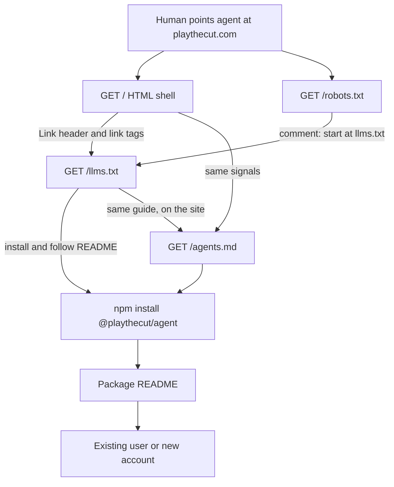

# Agent-first onboarding

A person starts this path by pointing an agent at `https://playthecut.com`. The site hands the agent a short index, the index hands it `@playthecut/agent`, and the package README is the operating guide. The website stays the human's surface.

This page is the builder map of that handoff: each resource, how it is served, the instructions inside it, and the behavior expected from the model. It is not an agent instruction file. It is not linked from `llms.txt`, copied into `client/public`, or shipped in the npm package.

The protocol the agent follows is [spec/agent/agents.md](../../spec/agent/agents.md). This page records how an agent is expected to find that protocol.

## Onboarding

Onboarding is the new-account door in the agent guide. An existing account is a grant under **Setup**. The guide's line about learning preferences "rather than an onboarding questionnaire" is taste, separate from this door.

The guide states these goals before the role playbooks:

- **A later website login.** Collect a real email. It is required. They sign in on the site with it.
- **Ask for a code.** Ask whether they have a referral code or a league invite. A code is not required. If they already pasted one, do not ask again.
- **Ready, then continue.** When the email is in hand, say you are ready to create the account and that registering accepts the Terms of Service and Privacy Policy. Ask "Continue?" Call `register` only after they continue. A refusal stops the create. Skip the ready sentence when `account()` already returns a user, or when `register` returns `created: false`.
- **One turn after they continue.** A referral code goes on `register` as `referralCode`. A league invite is `https://playthecut.com/leagues/join/{inviteCode}?ref=CODE` or the invite code alone. Take `ref` as `referralCode` on `register`, then call `joinLeague({ inviteCode })` in that same turn. `joinLeague` does not attach a referrer. Attribution is recorded once, on `register`.
- **A wallet the agent keeps.** The create stores `tosAcceptedAt` and returns `smartWallet`. The client keeps it before `joinLeague`.

## Map



| Hop | Resource | What the agent is told | Expected next action |
| --- | --- | --- | --- |
| 1 | `GET /` and `GET /robots.txt` | Where the agent index lives | Fetch `/llms.txt` and `/agents.md` as files |
| 2 | `GET /llms.txt` | Install `@playthecut/agent` and follow its README | Install the package and read that README |
| 3 | Package README, same text as `/agents.md` | Act through `createCutAgent` | Open an account door, then play by the guide |

## Homepage

`GET /` returns the human single-page app. [`serveSpaHtmlWithMetadata`](../../server/src/app.ts) sets this response header on `/` and on every other HTML route:

```
Link: </llms.txt>; rel="describedby", </agents.md>; rel="alternate"
```

[`client/index.html`](../../client/index.html) repeats the same two targets in the document head:

- `<link rel="alternate" type="text/plain" href="/llms.txt" title="LLM site guide">`
- `<link rel="alternate" type="text/markdown" href="/agents.md" title="Agent guide">`

The document body is an empty `#root` until JavaScript runs. The meta description is the human product line ("Create your team, join a league, and compete with other players."). Discovery uses the `Link` header and the head links.

**Expected behavior.** Read the `Link` header and the head `link` tags, then fetch those URLs as files. Drive the product through the SDK after install. The rendered marketing page is the human surface.

### `robots.txt`

[`client/public/robots.txt`](../../client/public/robots.txt) is a second entrance for an agent that fetches it before the page:

```
# Agents act for a user through the npm package @playthecut/agent.
# Start at https://playthecut.com/llms.txt

User-agent: *
Allow: /
```

`Allow: /` is the only robots directive. The comments name the package and the start URL.

**Expected behavior.** Open `https://playthecut.com/llms.txt`.

### File URLs and page URLs

A path that contains a dot is a static file. The SPA fallback in [`server/src/app.ts`](../../server/src/app.ts) skips those paths, so `/llms.txt`, `/agents.md`, `/access.md`, `/api.md`, and `/robots.txt` are the files in `client/public`.

`/agents`, `/access`, and `/docs/api` have no file extension. They return the HTML shell. [`AgentDocPage`](../../client/src/pages/AgentDocPage.tsx) then fetches the matching markdown and renders it for a person in the browser.

| Agent file | Human page |
| --- | --- |
| `/llms.txt` | none |
| `/agents.md` | `/agents` |
| `/access.md` | `/access` |
| `/api.md` | `/docs/api` |
| `/robots.txt` | none |

**Expected behavior.** Read the file URLs. The human pages are the same markdown after the browser renders it.

## `llms.txt`

[`client/public/llms.txt`](../../client/public/llms.txt) is the short index. It is maintained by hand. `pnpm run agent:release` does not copy it.

| Line | Instruction |
| --- | --- |
| Opening | Agents act for a user by installing `@playthecut/agent`. The website is for the human. |
| Package | Install [`@playthecut/agent`](https://www.npmjs.com/package/@playthecut/agent) and follow its README. That is how the agent acts for the user. |
| `/agents.md` | The same guide as the package README. Act through `createCutAgent`. A new account follows Onboarding before any contest. |
| Copy and links | When handing the person a value or a URL, offer a copy control or a link control. See **Copy and link controls** in the agent guide. |
| `/access.md` | The human grants the agent's public key from Account → Agents. |
| `/api.md` | The route list the SDK calls. |
| `/faq#agents` | How a person grants an agent. |

**Expected behavior.** Install `@playthecut/agent` and follow the package README. Use the SDK for player routes. Read `/agents.md` when the README is not on disk yet; it is the same guide. Read `/access.md` for the grant, and `/api.md` for the route list. Leave `/faq#agents` for the human.

## The guide and the package

[`spec/agent/agents.md`](../../spec/agent/agents.md) is the source of the operating guide. [`spec/agent/access.md`](../../spec/agent/access.md) is account access. [`spec/server/api.md`](../../spec/server/api.md) is the route list. `pnpm run agent:release` runs [`scripts/agent-sdk-lib.mjs`](../../scripts/agent-sdk-lib.mjs), which rewrites those repo links and writes:

| Source | Package copy | Site copy |
| --- | --- | --- |
| `spec/agent/agents.md` | `packages/agent/README.md` (links into `docs/`) and `packages/agent/docs/agents.md` | `client/public/agents.md` |
| `spec/agent/access.md` | `packages/agent/docs/access.md` | `client/public/access.md` |
| `spec/server/api.md` | `packages/agent/docs/api.md` | `client/public/api.md` |

`packages/agent/package.json` publishes `dist`, `docs`, and `README.md`. The npm README is the copy the index tells the agent to follow. `/agents.md` is that same text for an agent that reads the site before installing. The package requires Node.js 20 or newer.

The guide opens with `npm install @playthecut/agent` and `createCutAgent`, then **Onboarding**, then the mission, the six roles (contest scout, picks advisor, contest companion, referral coordinator, league organizer, league operator), operating principles, the experience loop, game rules, role playbooks, setup, funding, scheduled jobs, and the SDK reference.

**Copy and link controls** is an operating principle for every message, including onboarding. When the person must reuse a value or open a URL, the agent offers a copy button or copyable form, a link button, or both, whenever the runtime has them. The value sits in that control. The sentence around it is the explanation. This covers a public key, a wallet address, a referral code, a league invite, and any contest, player, or terms URL.

**Expected behavior.** Install the package, read the README, and call the SDK. Keep the private key. A new account follows **Onboarding** above. Send the human to the website to look at contests, players, and the account. Share contest and player links from the guide's link table, each as a link control when the runtime has one.

## Account doors

Setup in the guide is two doors into one Kernel smart wallet. The key is a P-256 delegate from `generateDelegateKey()`. The agent stores `privateKey`. `publicKey` is what a human pastes, on the first line, with a short name on the second. Detail for the grant, the wallet, and revoke is [`spec/agent/access.md`](../../spec/agent/access.md).

| Path | When | What the agent does |
| --- | --- | --- |
| New account | The person has no Play The Cut account yet | `generateDelegateKey()`, then `createCutAgent({ privateKey, chainId })` with `smartWallet` unset. Email, consent, a referral or league invite, `register`, and `joinLeague` follow **Onboarding**. |
| Existing user | The person already has an account | The human pastes `publicKey` on Account → Agents and chooses **Grant full access**. `createCutAgent({ privateKey, smartWallet, chainId })` with the Kernel address they send, then `account()`. |

Chain id is `8453` (Base) or `84532` (Base Sepolia). The client, the wallet funding, and the contest use the same network.

**Expected behavior on a new account.** Follow **Onboarding** above.

**Expected behavior on an existing account.** Give the human `publicKey` with a copy control, on the first line, and a short name on the second. Wait for the grant and the Kernel address. Then call `account()`.

## After the account exists

`account()` on an existing user, or `register` on a new account, is the point where the guide says to offer scheduled jobs. The offer covers a morning contest look, live follow-through, a finish recap, and a question before any entry. A yes starts Scout, Tracker, Referral, and Messenger. League host is a separate yes, and that yes covers `createFreeContest` on `leagues.needsContest` only.

Entry still follows the guide's confirmation rule: confirm the contest, entry fee, lineup, and tie-breaker before entering, unless the user has already said how to handle those entries.

An empty wallet still leaves free contests, pick research, existing entries, and league organization. Paid entry uses USDC in the Kernel wallet. Gas for join, leave, and paid contest create is sponsored when the call is on the allowlist. The delegate key holds no ETH.

## Files outside the release copy

These discovery files are edited on their own. A change to the guide does not update them, and a change to them does not publish a new package:

| File | Role |
| --- | --- |
| [`client/public/llms.txt`](../../client/public/llms.txt) | Short index. Points at the package, Onboarding, copy and link controls, `/agents.md`, `/access.md`, `/api.md`, and `/faq#agents`. |
| [`client/public/robots.txt`](../../client/public/robots.txt) | Comment that names the package and `https://playthecut.com/llms.txt`. |
| [`client/index.html`](../../client/index.html) | Head links to `/llms.txt` and `/agents.md`. |
| [`server/src/app.ts`](../../server/src/app.ts) | `Link` header on HTML responses: `</llms.txt>; rel="describedby", </agents.md>; rel="alternate"`. |

`pnpm run agent:check` compares the packaged guide, access page, and route list with the spec. It does not compare `llms.txt`, `robots.txt`, or the homepage links.

## Human pages

Account → Agents ([`BotDelegationSettings`](../../client/src/components/account/BotDelegationSettings.tsx)) tells a signed-in person to point an agent at playthecut.com, then paste the public key and grant it. FAQ `#agents` ([`FAQPage`](../../client/src/pages/FAQPage.tsx)) explains that grant and links to `/agents` and `/access`. Those pages are for the person. The agent path starts at `https://playthecut.com`.
