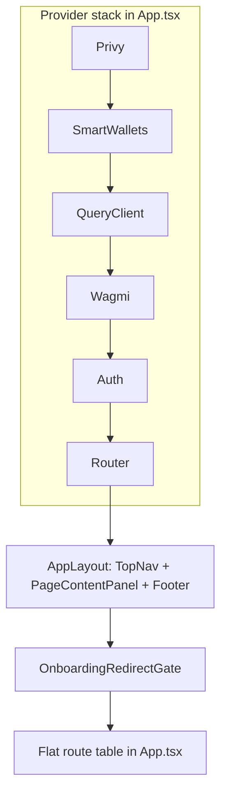
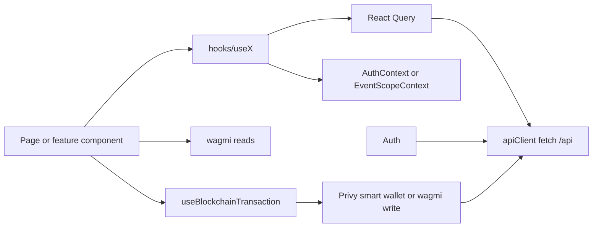
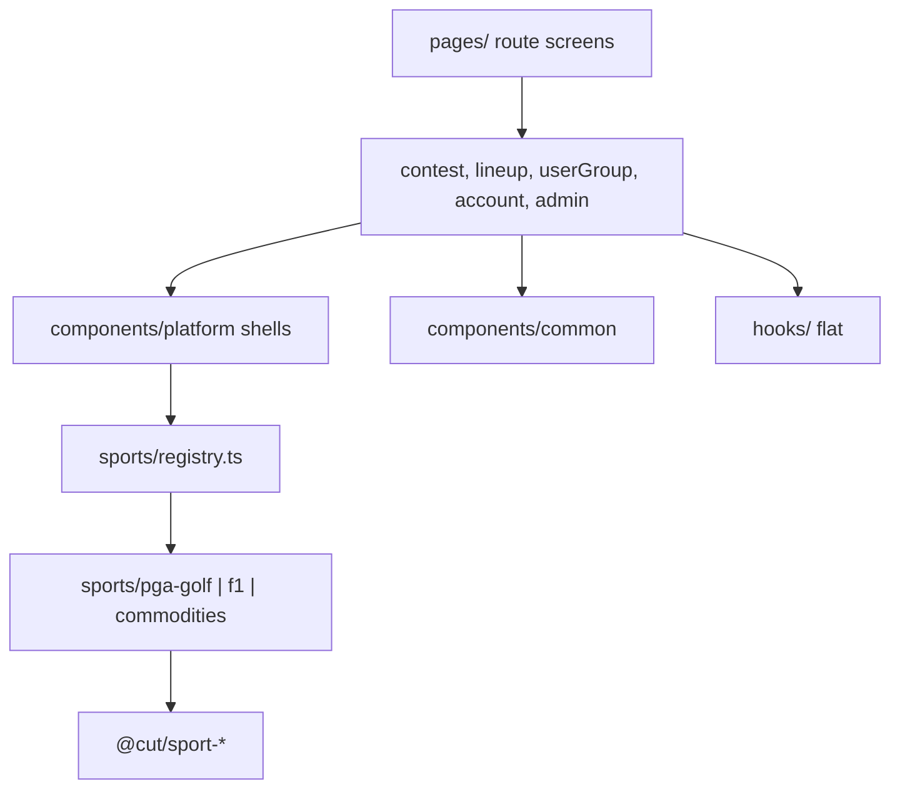
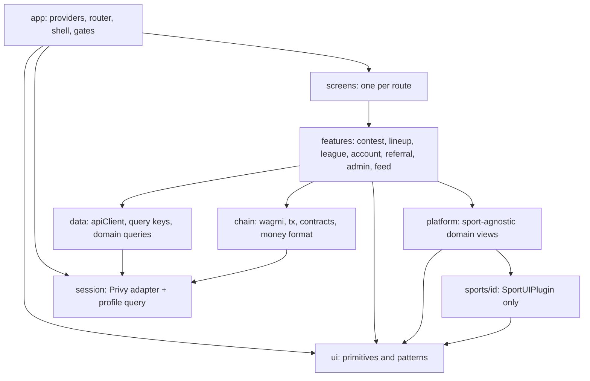
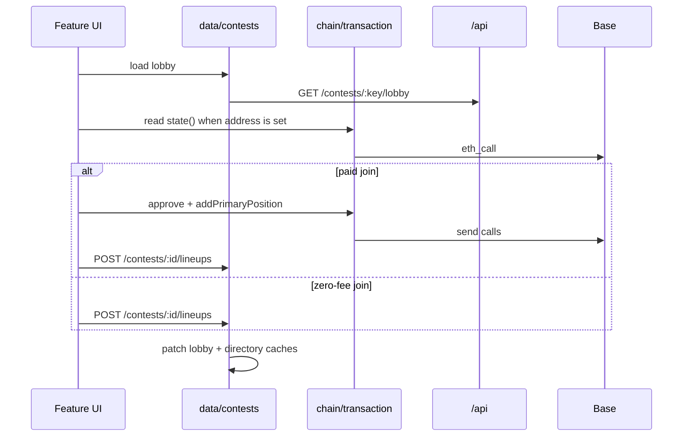

# Client architecture plan

Greenfield target for the Play The Cut web client: the same product, the same stack, a cleaner set of layers. This is the shape to build toward. It is a target architecture, not a rewrite schedule.

The product stays one app. A user picks a sport, builds a lineup from that event’s candidate pool, and enters contests — public or inside a league. Account, wallet, and referral graph are shared. Sport presentation is a plugin. Paid contests deploy through `ContestFactory` / `ContestController`; `$0` contests stay in the database. Live scores arrive on the server cron cadence (five minutes). Commentary arrives on Stream.

Canonical product model: [architecture.md](architecture.md). This document is the client shape that model implies once the current leaks are closed.

---

## Current shape

React 19, TypeScript, Vite 6, React Router 7. Server cache is TanStack Query. Auth and the smart wallet are Privy. Chain reads and writes are wagmi and viem on Base (or Base Sepolia when `VITE_TARGET_CHAIN` is not `mainnet`). UI is Tailwind 3, Headless UI, and Heroicons. Sport contracts and candidate types come from `@cut/sport-sdk`. Each sport’s presentation lives in `client/src/sports/<id>/` and its logic package (`@cut/sport-pga-golf`, `@cut/sport-f1`, `@cut/sport-commodities`). Commentary uses `@stream-io/feeds-react-sdk` when `VITE_STREAM_API_KEY` is set. Analytics is PostHog in production only.

Entry is `client/src/main.tsx` → `client/src/App.tsx`. Every route renders inside one shell.





Paid create, join, leave, and winner-pool buys write the chain first, then POST or DELETE. Lineups, leagues, referrals, and `$0` contests are API only.

### How the code is actually laid out

| Area | Where it lives |
| --- | --- |
| Routes, providers, gates | `client/src/App.tsx`, `components/common/ProtectedRoute.tsx`, `components/routing/LegacyRedirects.tsx` |
| Shell | `components/layout/` — `AppLayout` (`max-w-shell` = 56rem, `bg-slate-100`), `TopNav`, `MobileNavMenu`, `UserMenu`, `PagePanel`, `Footer` |
| Nav data | `lib/navTabs.ts`, `lib/navRoutes.ts`. Footer legal links are a separate list in `Footer.tsx` |
| Server state | `utils/apiClient.ts`, `utils/queryKeys.ts`, `lib/queryClient.ts`, `hooks/use*.ts` |
| Session | `contexts/AuthContext.tsx` — Privy facade over `queryKeys.user.profile()` (`GET /auth/me` through `apiClient`). Payment-token balance still polled here |
| Lobby scope | `contexts/EventScopeContext.tsx` — `sportId` and event shell for the open contest |
| Chain | `wagmi.ts`, `hooks/useBlockchainTransaction.ts`, `utils/contracts/*.json`, `config/targetChain.ts` |
| Sport UI | `sports/registry.ts` plus `sports/pga-golf/`, `sports/f1/`, `sports/commodities/` |
| Platform shells | `components/platform/` — picker, event header, participant row, lineup panel |
| Features | `components/contest/`, `lineup/`, `userGroup/`, `account/`, `admin/`, `auth/` |
| Screens | `pages/` — route components, including `pages/account/` |
| Shared kit | `components/common/` — `Modal`, `ListHeader`, spinners, `ErrorMessage`, copy/share, route gates. No `Button` or `TextField` |
| Types | `types/` hand-copied HTTP shapes. Domain candidates from `@cut/sport-sdk` |

### Component layers today



`pnpm run check:sport-boundary` (`scripts/check-sport-boundary.mjs`) forbids `@cut/sport-pga-golf`, `@cut/sport-f1`, and `@cut/sport-commodities` under `server/src/services`, `lib`, `utils`, `routes`, and `cron`, and under `client/src/lib`, `components`, `hooks`, `pages`, and `contexts`. Sport packages are imported from `client/src/sports/**` and test fixtures. Status, period labels, commentary parsing, and display-name checks go through `@cut/sport-sdk` or the registered plugin.

`spec/client/state-management.md` still says `EventScopeContext` holds candidates, and React Query Devtools are not mounted. `spec/client/README.md` still lists the sport UI as `pga-golf` only. This plan is the target; `spec/client/` is the as-built note.

---

## Problems that justify a different shape

Verified in the client. Grouped by the boundary they break.

### Shell copy names golf

A new sport is a package, a `Sport` row, a server module, and a `SportUIPlugin` registration. The registry and `check:sport-boundary` keep sport packages out of platform files. `SportPredictionField` reads `predictionRules` for the given `sportId`. Roster size comes from `GET /sports` and is undefined until that sport is in the catalog.

The shell copy still names golf:

| File | What it hardcodes |
| --- | --- |
| `client/src/lib/brand.ts` | `DISCORD_TAGLINE` (“talk golf”), `BRAND_TAGLINE` (“Play The Cut Fantasy Golf”). Rendered from nav and `pages/Home.tsx`. |
| `pages/Home.tsx`, `pages/FAQPage.tsx` | Golf-only product copy (four golfers, Stableford, PGA stroke count) inside the shared shell. `Home` imports `sports/pga-golf/InfoScorecard` (pages may import a sport folder). |

The three `CandidateRow` implementations repeat the same scheduled-card vs live-row switch.

### Session, queries, and chain are three styles of “data”

Profile reads and writes go through `apiClient` and `queryKeys.user.profile()`. League create, settings, and member removal use `apiErrorMessage`. Join league branches on `isApiError` status codes. There is no app-wide error overlay.

What is still split:

- Chain reads (`useBalance`, contest `state()`, prediction quotes) sit in feature hooks with their own stale times. The payment-token balance is polled every 30s inside `AuthContext` and formatted again in `UserMenu` and `MobileNavMenu`.
- `queryKeys.user.contests()` and `queryKeys.contests.byEvent()` are invalidated from `useContestMutations.ts` and have no `useQuery`. `useLineupQuery` caches the event lineup list under a second key and is unused.
- Lobby and timeline polls are gated (`isContestLiveTracked` in `useContestQuery.ts`: five minutes while `ACTIVE` or `LOCKED` and the event is not complete). Candidate and lineup queries poll that same interval whenever they are mounted (`useSportData.ts`, `useLineupQueries.ts`), including settled lobbies.
- There is no React error boundary.
- `ContestDirectorySections` forwards `error` only into the upcoming group. An empty directory with a failed fetch renders a blank column.

### UI has a shell and no kit

Tailwind tokens in `client/tailwind.config.cjs` name `gray.25`, three max-widths, Inter, Outfit, and a type scale (`display-lg`, `body`, `stats`, …). Nothing in `client/src` uses `text-display-*`, `text-body`, or `text-stats`. Buttons are a copied `bg-blue-500` string with drifting radius and height. `ContestCard.tsx` uses `text-grey-900`, which is not a Tailwind color in this config.

`index.css` sets `outline: none !important` and `box-shadow: none !important` on `:focus` and `:focus-visible` for the whole document.

Status is often a washed panel: `ErrorMessage` is `bg-red-50`; `Connect.tsx` uses a green-50 referral strip; `AdminStatCard` uses emerald-50 / amber-50 / gray-50; wallet and payouts use amber-50 bars; create-contest and `WalletBalancePanel` use blue-50 wells. That fights the house rule: high-contrast ink and white, status as a solid action. Solid marks that already fit — the green open dot and blue live dot on `ListHeader`, emerald numerals on the pot — should stay.

`postcss.config.cjs` loads Tailwind 3 (`tailwindcss` + `autoprefixer`). Smart-account batching goes through Privy’s `sendTransaction({ calls })` in `useBlockchainTransaction.ts`.

### Names and files split one product concept

Leagues are `/leagues` in the router and “League” in the nav. Pages, components, hooks, query keys, and the API are `UserGroup` / `/userGroups`. `accountMatch` in `lib/navRoutes.ts` treats league URLs as account-active, so the balance button highlights on league pages. `LEAGUES_TAB.match` covers nested league URLs; `UserMenu` and `MobileNavMenu` only highlight the parent row on the exact list path.

`ContestCard` is the lobby pot strip. Directory rows are `EventCardFrame` + `ContestListItem`.

Discord and store links are copied across `TopNav`, `UserMenu`, and `MobileNavMenu`. The store URL is a string literal in each; labels come from `brand.ts`.

### Screens that own too many jobs

These files mix orchestration, chain or HTTP calls, and presentation. They are the files that grow when a sport or a contest rule is added:

- `contexts/AuthContext.tsx` — Privy, chain switch, profile bootstrap, settings writes, token balance
- `components/contest/PredictionEntryForm.tsx` — quote, amount, approve, buy, API record
- `components/contest/CreateContestForm.tsx` and `components/userGroup/LeagueCreateContestForm.tsx` — two create UIs, one submit hook
- `components/lineup/LineupContestCard.tsx` and `components/lineup/GuestLineupPicker.tsx` — two slot editors (`useLineupSlotEditor` vs local state)
- `pages/FAQPage.tsx` and `pages/OnboardingPage.tsx` — long screens with inline markup and no content module

---

## Target architecture

Same libraries. The change is ownership: what may import what, where a query lives, and which layer a new sport is allowed to touch.

### Stack decisions

| Keep | Why |
| --- | --- |
| React 19, Vite 6, TypeScript, React Router 7 | Already the app. Route table and shell are the right size for one deployment. |
| TanStack Query + one `fetch` wrapper | Caching, polling, and optimistic join/leave already work. |
| Privy + `@privy-io/wagmi` + viem | Login, embedded wallet, Base, sponsorship via `VITE_PIMLICO_SPONSORSHIP_POLICY_ID`. |
| Tailwind 3 + `@tailwindcss/forms` | The live pipeline. Name the colors and type roles that screens already use. |
| Headless UI (`Dialog`, `Tab`, `Menu`, `Disclosure`) + Heroicons | The primitives wrap these. A second headless kit adds a second interaction model. |
| `@cut/sport-sdk` and per-sport packages | The plugin contract is the extension point. Widen it; do not replace it. |
| Stream Feeds for contest commentary | The only realtime channel. Scores stay on the five-minute cron poll. |
| Vitest for pure decisions, Storybook for visual catalog | Matches what the repo can already run. |
| PostHog in production, `autocapture: false` | Analytics, not a flag service. |

The client dependency set does not include `react-hook-form`, `@hookform/resolvers`, `yup`, `zod`, `permissionless`, or `@tailwindcss/postcss`. Chain submits are multi-step transactions, not schema forms. Zod remains the server request validator (`server/src/schemas/`). Batching is Privy’s smart-wallet client. A Tailwind v4 migration is a tooling project after color and type roles exist, and it is not required for this architecture.

Do not add Zustand, Redux, a toast library, Radix, `cva`, or shadcn. `lib/tabStyles.ts` already exports a small `cn`.

### Layering



Import rules:

| Layer | May import | May not import |
| --- | --- | --- |
| `ui` | Tailwind roles, Headless UI, Heroicons | features, data, chain, sports, session |
| `sports/<id>` | `@cut/sport-<id>`, `@cut/sport-sdk`, `ui` | features, pages, `apiClient`, wagmi |
| `platform` | `@cut/sport-sdk`, `sports/registry`, `ui`, data hooks that return `Candidate` / event shell | `@cut/sport-pga-golf`, `@cut/sport-f1`, `@cut/sport-commodities` |
| `data` | `apiClient`, `@cut/sport-sdk` types | React components, sport packages |
| `chain` | wagmi, viem, contract JSON, session address | sport packages, feature components |
| `session` | Privy, `apiClient`, wagmi chain id | feature UI |
| `features` | platform, data, chain, ui, session hooks | a specific sport package |
| `screens` | one feature’s public components, route params | `fetch`, contract ABIs, sport packages |
| `app` | screens, session, shell | contest or lineup internals |

`client/src/sports/registry.ts` is the only client module outside `sports/<id>/` and `client/src/pages/` that imports sport UI plugins. `scripts/check-sport-boundary.mjs` enforces that for `client/src/lib`, `components`, `hooks`, `pages` (package imports), and `contexts`.

### Folder / module map

Target layout. Names are the public modules. Today’s paths are the source material, not a mandatory move on day one (see Migration).

```
client/src/
  app/
    providers.tsx          Privy, smart wallets, query, wagmi, session, router
    router.tsx             route table
    gates.tsx              ProtectedRoute, AdminRoute, OnboardingRedirectGate
    shell/                 AppLayout, TopNav, MobileNavMenu, UserMenu, Footer
    nav.ts                 one list: primary, account, overflow (Discord, store)
  screens/                 today’s pages/, thin
  features/
    contests/              directory, lobby, create, payouts, predictions
    lineups/               slot editor, contest card, guest picker
    leagues/               today’s userGroup/ UI, still talking to /userGroups
    account/               settings, activity, wallet screens
    referrals/
    admin/
    feed/                  Stream session, contest feed, mention badge
  platform/                today’s components/platform
  sports/
    registry.ts
    pga-golf/ f1/ commodities/
  ui/                      Button, TextField, Modal, Tabs, ListHeader, StatusDot, PageSection
  data/
    apiClient.ts
    queryKeys.ts
    queryClient.ts
    sports.ts contests.ts lineups.ts leagues.ts account.ts admin.ts
  chain/
    wagmi.ts
    targetChain.ts
    contracts/             address JSON + ABIs
    transaction.ts         today’s useBlockchainTransaction
    money.ts               6-decimal payment token format
    escrow.ts              hasOnchainEscrow, contestRouteKey
  session/
    AuthProvider.tsx       facade over the profile query
    token.ts               today’s lib/authToken.ts
```

Flat `hooks/` dissolves into the module that owns the behavior: query hooks beside their domain in `data/`, chain hooks in `chain/`, slot-editor state in `features/lineups/`. A hook that only a screen uses stays next to that screen.

### Data flow

Three states, three owners.

| State | Owner | Examples | Update path |
| --- | --- | --- | --- |
| Server | React Query | sports, directory, lobby, timeline, lineups, leagues, profile, referrals, activity | `data/*` query functions. Mutations invalidate the keys they write. |
| Session | `session/` facade | Privy authenticated flag, `AuthUser`, odds format, onboarding flag | Profile query. Settings mutations write through `apiClient` and update that query. |
| Chain | wagmi + `chain/transaction.ts` | balances, `ContestController.state`, prediction quotes, factory receipts | Reads colocated with the feature. Writes only through `transaction.ts`. |
| UI | component state | slot draft, modal open, form draft, onboarding step index | Dies with the screen. |

Direction: screens call feature actions. Feature actions call `data` or `chain`. Components do not call `fetch`. The chain module does not know about React Query keys; the feature mutation does: receipt, then API, then invalidate.



**Where queries live.** One file per resource, keys only from `queryKeys.ts`.

| Query | Endpoint | Freshness |
| --- | --- | --- |
| Sports catalog | `GET /sports` | 24h. Roster, prediction, and period rules come from here. |
| Active event | `GET /sports/:id/events/active` | Five minutes. Used by create-contest and the legacy leaderboard redirect. |
| Candidates | `GET /sports/:sportId/events/:eventId/candidates` | Five minutes while the event is `SCHEDULED` or `LIVE`. No interval once `COMPLETE`. |
| Directory | `GET /contests/directory` | 15 minutes stale, refetch on focus, no interval. Keep previous data. |
| Lobby | `GET /contests/:key/lobby` | Five minutes while contest is `ACTIVE` or `LOCKED` and the event is not complete. Otherwise stale forever until focus or invalidation. |
| Timeline | `GET /contests/:key/timeline` then `?since=` | Same gate as lobby. Disabled while `OPEN`. Merge with the existing timeline helper. |
| Lineups | `GET /lineups/:eventId` | Five minutes while a lineup on screen is still editable or its contest is live. No interval on a settled lobby. |
| Profile | `GET /auth/me` | Session query. Invalidated on settings save, league join, logout. |
| Leagues | `/userGroups` | Invalidated on create, join, settings, membership. |
| Referrals | `GET /auth/referrals/summary` | Long stale time (today: 12h). |
| Activity | `GET /auth/transactions` | Minutes, not the cron interval. |
| Stream token | `GET /stream/token` | Key lives in `queryKeys`. |

**Live scores.** The cron writes `EventParticipant.total` and contest lineup scores. The client does not open a scores socket. Mounted live surfaces refetch on `SERVER_SYNC_INTERVAL_MS` (`client/src/lib/queryTiming.ts`). Placeholder lobby data from navigation state or the directory cache stays, so a refetch does not blank the page.

**Commentary.** `features/feed` subscribes to Stream feed group `contest`, id = contest UUID, when the API key and a session exist. Reactions stay on that client. The JSON fallback (`contest.commentaryFeed`) is parsed by a function in `@cut/sport-sdk`, because the lobby is sport-agnostic. Golf hole fields stay optional on that document type. A sport that needs a different document implements a plugin parser; the panel calls the registry, not `@cut/sport-pga-golf`.

**Balance.** One `useBalance` on the payment token for the smart-wallet address (fallback: wagmi account). Nav, wallet page, and join-funds check read that query. Formatting goes through `chain/money.ts` (6 decimals, symbol from chain metadata, USDC vs xUSDC from `targetChain`).

Dead keys (`user.contests`, `contests.byEvent`) are removed until a query owns them. Invalidation lists only keys that exist.

### Sport extension points

A sport implements two contracts. The platform shell implements neither.

**Data contract** — already on the server and in `@cut/sport-sdk`: `SportModule`, `RosterRules`, `ScoringRules`, `PredictionRules`, `Candidate`, `candidateSortConfig`. The client reads rules from `GET /sports`. It does not re-declare slot counts.

**UI contract** — `SportUIPlugin` in `packages/sport-sdk/src/sport-ui-plugin.ts`, registered in `client/src/sports/registry.ts`. Resolved by `useSportUIPlugin(sportId)` from the URL or from `EventScopeContext`. Missing plugin throws at the shell that needs it (`requireSportUIPlugin`). There is no default sport.

Target plugin surface:

| Slot | Required | Responsibility |
| --- | --- | --- |
| `CandidateRow` | yes | Picker row. Scheduled card vs live row is one platform wrapper; the plugin supplies the scheduled card and `ParticipantRow`. |
| `ParticipantRow` | yes | Field list and lineup slot. |
| `ParticipantDetail` | yes | Modal body. |
| `EventSummary` | yes | Hero and content surfaces. |
| `resolveEventHeroImage` | yes | Image URL or null. |
| `candidateSortConfig` | yes | From the sport package. |
| `eventStatus(metadata)` | yes | `SCHEDULED` \| `LIVE` \| `COMPLETE`. Replaces the if-chain in `eventMetadata.ts`. |
| `formatEventStatus(status, metadata)` | yes | Label. |
| `eventStart(metadata)` / `eventEnd(metadata)` | yes | ISO strings or null. |
| `periodRules` | when the sport has periods | Replaces `PERIOD_RULES_BY_SPORT`. Prefer the value on `GET /sports` when the API sends it; the plugin is the fallback shipped with the build. |
| Hero class names | no | Already optional on the type. |

`PredictionField` comes off the plugin. Every current sport uses a numeric `winningLineupTotal` slider whose min, max, step, scale, and label come from `Sport.predictionRules`. `SportPredictionField` renders `LineupWinningScoreSlider` from those rules only. A sport id is required; the component has no `"pga-golf"` branch. A future sport that needs a non-numeric tie-break adds a slot then, with a platform default of “rules-driven slider.”

**Platform keeps:** routing, directory, lobby tabs, lineup save/join, contest create, leagues, wallet, referrals, ranking display, popularity display after lock ([consensus-axis.md](consensus-axis.md)), tie-break ordering display ([lineup-tie-breaker.md](lineup-tie-breaker.md)).

**Sport keeps:** row contents, detail body, hero image, status words, period labels, sort keys, scorecard or sparkline. Golf scorecard types stay inside `sports/pga-golf/`. Commodities charts stay inside `sports/commodities/`.

Copy that ships in the shell (`brand.ts`, Discord tagline) names the product, not a sport. Golf marketing copy lives on a golf surface or in FAQ content keyed by sport, not in `Home` as the default app voice. `/` already redirects to `/contests`.

### Component hierarchy

Five layers. A file lives on the lowest layer that still describes its job.

| Layer | Job | Current examples that belong here |
| --- | --- | --- |
| App shell | Chrome, nav, gates, width | `AppLayout`, `TopNav`, `MobileNavMenu`, `UserMenu`, `Footer`, `ProtectedRoute`, `OnboardingRedirectGate` |
| Route screen | Bind the URL, call one loader, pick the feature | `ContestListPage`, `ContestLobbyPage`, `LeaderboardPage`, `UserGroupDetailPage`, `WalletPage`, `OnboardingPage`, `AdminPage` |
| Feature composition | A task across several views | `ContestDirectorySections`, `ContestLobbyView`, `EventLineupsPanel`, `CreateContestForm`, `ReferralNetworkPanel` |
| Domain view | One sport-agnostic object | `SportEventHeader`, `EventHeroPanel`, `EventCardFrame`, `CandidatePicker`, `SportLineupPickRow`, `ContestListItem`, lobby `ContestCard` (pot strip — name it for the pot, not “card”), `LineupWinningScoreSlider` |
| Sport view | Injected by the registry | `pga-golf/ParticipantDetail`, `f1/EventSummary`, `commodities/CandidateSelectionCard` |
| Primitive | Visual atom with no domain words | `Modal`, `ListHeader`, `LoadingSpinner`, `PageSection`, and the Button / TextField / Tabs / StatusDot described below |

Screens do not contain contract ABIs or candidate-row markup. Domain views do not branch on `sportId === "pga-golf"`. Sport views do not navigate or call the API.

Lobby composition stays a tab shell: Lineups, Contest, Pool, Cutbot, Results. Children own their panels (`EventLineupsPanel`, predictions, feed, results, timelines). The page owns the lobby query, the timeline query, and on-chain `state()` → the existing view-model helper (`deriveContestLobbyViewModel`).

Guest lineup and signed-in lineup share one slot-editor state machine. The guest path skips the mutation and shows the sign-in prompt. The signed-in path calls `PUT /lineups/:id`.

### Design hierarchy

The visual character is the one already in the shell: slate canvas, white paper, Outfit for headings and actions, Inter for body, solid blue actions, emerald only as a numeral. [brand.md](brand.md) covers the wordmark and USDC naming; this section covers the UI.

#### Foundations

Defined in `tailwind.config.cjs` and applied by primitives. Raw utilities in feature files use these names.

| Role | Value | Use |
| --- | --- | --- |
| canvas | `slate-100` (`#f1f5f9`) | `html` background and `AppLayout`. Storybook canvas uses the same hex, not `gray-100`. |
| paper | `white` | Nav, cards, modals, list rows |
| ink | `slate-900` | Titles, primary text |
| muted | `slate-500` | Secondary text, meta |
| line | `slate-200` | Borders and dividers |
| action | `blue-500`, hover `blue-600` | Primary buttons, live dot, links that are actions |
| on-action | `white` | Text on action fill |
| money | `emerald-600` | Pot, payout, referral totals. Type and solid icons only |
| live | `blue-500` dot | Live events, “Live Contests” |
| open | `green-500` dot | Open for entry |
| danger | `red-600` | Error text and a solid destructive button |

One action blue. Privy variables in `index.css` (`--privy-color-accent` is `#2563eb` today; app buttons are `#3b82f6`) move to the action value so the login modal matches Sign In.

Stop using `gray-*` and `slate-*` for the same role. `gray.25` can go once nothing references it. Delete `text-grey-900`.

**Type.** Outfit via `font-display` and the existing `h1–h6` rule. Inter via `font-sans`. Replace the unused `display-*` / `body` / `stats` scale with the roles screens already use:

| Role | Size | Where |
| --- | --- | --- |
| wordmark | `text-4xl`–`text-6xl`, wide tracking, Outfit | `BrandLogo` lockup |
| title | `text-2xl sm:text-3xl`, Outfit | Event hero (`eventHeaderTone`) |
| label | `text-sm uppercase tracking-wider`, Outfit | `ListHeader` |
| ui | `text-sm`, Inter | Rows, forms, nav items |
| meta | `text-xs`, `slate-500` | Timestamps, secondary lines |
| money | `text-base` or larger, Outfit, `emerald-600`, tabular nums | Pot and balances |

**Space.** The shell is `max-w-shell` (56rem). Modals are `max-w-modal` / `max-w-modal-wide`. Section gap on the directory is the current `mt-8` between groups. Controls share one height: `h-10` for list CTAs and primary buttons, a compact `h-8` for inline row actions.

**Radius.** `rounded-md` for controls and list rows. `rounded-lg` for panels (`PageSection` card) and modals. Two named radii, used only by primitives.

**Motion.** `skeleton-pulse` for loading blocks. Headless `Transition` durations live on `Modal` and the mobile drawer. No extra animation library.

**Focus.** Remove the global `outline: none !important` block in `index.css`. Primitives set `focus-visible:ring-2 focus-visible:ring-blue-500 focus-visible:ring-offset-2`. The tap-highlight suppression can stay.

#### Primitives

| Primitive | Behavior |
| --- | --- |
| `Button` | `primary` (solid blue, Outfit, white), `secondary` (white, blue border — the Create Account treatment in `Connect`), `quiet` (white, slate border, slate text — cancel). One height scale. No tinted variants. |
| `TextField` | Slate border, blue focus, label, error as `text-red-600` under the field. Replaces emerald focus rings on `UserGroupForm`, `DisplaySettings`, and `OnboardingPage`. |
| `StatusDot` | `open` or `live`, the dots already on `ListHeader` and the nav. Optional solid label in ink, not a pastel pill. |
| `Tabs` | Headless `Tab` plus `tabStyles`. Lobby, wallet, admin, and league detail use this wrapper. |
| `Modal` | The only dialog. Enter/leave and close button live here. Full-bleed cases (mobile nav, candidate picker) use the same transition and close button. |
| `ListHeader` | Keep tones: default, upcoming, live, past. |
| `PageSection` | `default` divider or `card` (paper, line border, panel radius). |
| `Spinner` | One component, `size="sm" \| "md"`. |

`EventCardFrame` and `eventHeaderTone` stay domain views / platform helpers, not primitives. They already encode the event-card look.

#### Patterns

| Pattern | Composition |
| --- | --- |
| Directory group | `ListHeader` + `EventCardFrame` + `ContestListItem` rows. Primary `Button` for the row CTA. |
| Lobby identity | Event hero (`EventHeroPanel`) then the pot strip (today’s `ContestCard`): white paper, ink title, emerald numeral. |
| Lineup editor | Slot rows via `SportLineupPickRow`, picker via `CandidatePicker`, tie-break via the rules-driven slider, save as a primary `Button` that becomes a solid completed label after save (`CandidateSaveOverlay` already uses a solid slate overlay — keep that weight). |
| Form | `PageSection` card, `TextField` or `DiscreteValueSlider`, primary `Button`. |
| Insufficient funds / testnet note | Ink text on paper with a `line` border, or a solid `slate-900` bar with white text. |
| Error | `text-red-600` on paper, next to the action that failed. |
| Empty | One ink sentence and a primary action (“No leagues yet” + create). |

#### Stop

- Pale status panels: emerald-50, green-50, amber-50, blue-50, red-50 wells and `bg-*-100` status pills (`AdminStatCard`, `Connect` referral banner, `ErrorMessage`, `Home`, `FAQPage`, `Disclosures`, `WalletPage`, `ContestPayoutsModal`, `CreateContestForm`, `WalletBalancePanel`, `ContestList` connect hint, admin tables, `StagingBadge`).
- Emerald–teal gradient money hero in `contestPayoutPresentation.tsx`. The pot strip’s white paper and emerald numeral is the money treatment.
- Copied primary-button class strings.
- A second contest-create visual (blue-50 well vs Disclosure).
- New Headless `Dialog` copies beside `Modal` (`MobileNavMenu`, `ContestLineupJoinActions`, `SportParticipantDetailModal`, `CandidatePicker`, `ContestEntryModal`, `PredictionEntryModal`).
- Serif italics on `Home`.
- Grey-on-grey fills (`bg-gray-50` text on `slate-100`).

`StagingBadge` becomes ink on paper with a solid border, still gated on `import.meta.env.MODE === "staging"`.

### Cross-cutting

**Auth gates.** `ProtectedRoute` sends anonymous users to `/connect` with `state.from`. While the session query is pending it renders nothing (same as `AdminRoute` today). `AdminRoute` stays `userType === "ADMIN" | "SUPER_ADMIN"`. Public routes stay public: `/contests`, `/contest/:key`, event leaderboard, legal, FAQ. Join and create stay gated inside the feature when the route itself is public, and the control is a sign-in `Button`, not a tinted hint.

**Onboarding.** Still a server flag: `settings.onboardingDismissed === false` redirects to `/onboarding`. Step index can stay local. Skip and exit set the flag through the profile mutation. Pending league invite (`useLeagueInviteCapture`) still wins over the default return path.

**Errors.** Query `error` and empty `data` render the danger text pattern in the screen. `ApiError.message` and `code` are the only client error shape. League create, settings, and member removal use `apiErrorMessage`. Join league branches on status codes. Auth bootstrap failure stays on the connect screen (`serverSessionError`).

**Forms.** Local state plus a pure validate function beside the feature. HTML `required` is enough for a single text field. Cross-field checks (contest fees, send amount, prediction amount) are functions with unit tests. No form library.

**Money.** `chain/money.ts` is the only formatter. Human amounts in, wei out, via the existing `primaryDepositWeiFromHuman` path. Display uses `formatUnits` and the token symbol. User-facing copy says USDC (or xUSDC on testnet), per [brand.md](brand.md).

**Referrals.** `?ref=` capture in `sessionStorage` before auth, sent as `X-Cut-Referral-Code` on `POST /auth/session`. Unchanged. Display tree and stake copy stay pure functions in `lib/` (already tested).

**Flags.** There is no feature-flag system, and this architecture does not add one. Environment switches stay explicit:

| Switch | Effect |
| --- | --- |
| `import.meta.env.DEV` | `/debug` and commodity icon preview routes |
| `import.meta.env.MODE === "staging"` | Staging mark in the shell |
| `import.meta.env.PROD` and `VITE_POSTHOG_KEY` | Analytics provider |
| `VITE_TARGET_CHAIN` | Base vs Base Sepolia |
| `VITE_PIMLICO_SPONSORSHIP_POLICY_ID` | Paymaster context |
| `VITE_STREAM_API_KEY` | Commentary socket; absent means the JSON feed only |

**Loading.** First load of a list uses the spinner or a skeleton that matches the layout (lobby already has `ContestLobbyLoadingShell`). Refetch keeps the previous data. `GlobalLoadingOverlay` remains the cold-start gate until the session query resolves, with the current debounce so a fast session does not flash.

---

## System-by-system

### 1. App shell, routing, layouts, navigation

**Current.** One flat `<Routes>` in `App.tsx`. Every route sits in `AppLayout` → `PageContentPanel` → `OnboardingRedirectGate`. `getPagePanelVariant` ignores the path and always returns `"default"`. No 404 route. Legacy redirects cover `/user-groups/*`, `/sports/:sportId`, `/account`, `/referrals`. Nav tabs live in `lib/navTabs.ts`; matchers in `lib/navRoutes.ts`; several exports (`ADMIN_TAB`, `contestsHubMatch`, `leaderboardMatch`) are unused. Overflow links are duplicated in three menus. Sign-out lives on `SettingsPage`, not the menu.

**Keep.** Single shell and `max-w-shell`. Public contest directory and lobby. Protected account, leagues, create, onboarding, admin. Legacy redirects. Dev-only routes behind `import.meta.env.DEV`. Account sublinks and league submenu driven by data (`ACCOUNT_SUB_LINKS`, `leagueNavItemsFromAuth`). Footer legal links.

**Change.** One `app/nav.ts` describes primary, account, leagues, overflow, and admin. Desktop menu, mobile drawer, and footer consume it. League parent highlight uses the leagues matcher for every `/leagues` path. The balance control is active on `/account/*` only. Store URL lives next to `STORE_LABEL` in `brand.ts`. `pagePanelRoutes` either selects a real variant or goes away; the flush variant is not a secret API. Add a single unmatched route that renders an ink title and a link to `/contests`.

**Target.** `app/router.tsx` is the route table. `app/shell` has no sport copy and no contest queries. Screens opt into nothing: the shell is always the shell. `Home` is not a second marketing homepage unless a route actually lands there; `/` stays a redirect to `/contests`.

### 2. Data fetching and server state

**Current.** `apiClient` + React Query. Defaults in `lib/queryClient.ts`: stale 1 minute, gc 5 minutes, retry 1, refetch on focus and reconnect, mutations retry 0. Domain hooks are listed in the data-flow table above. Directory key includes user id or `"anon"`. Lobby placeholder comes from navigation state or directory cache. Join and leave patch lobby and directory optimistically (`useContestMutations.ts`). Timeline merges with `?since=`. Stream token uses an ad hoc key. `ReactQueryDevtools` is commented out in `App.tsx`.

**Keep.** `apiClient`, `ApiError`, `queryKeys` factory, directory vs lobby vs timeline split, optimistic join/leave, timeline merge, sports catalog stale time, cron-aligned interval constant, “keep previous data” on the directory.

**Change.** Candidate and lineup intervals use the same live gate as the lobby. Stream token uses `queryKeys`. Remove invalidations for keys with no query. Mount Devtools in development. Profile reads and writes already go through `apiClient` and `queryKeys.user.profile()`.

**Target.** `data/<resource>.ts` exports `useXQuery` and `useXMutation` only. Screens never import `apiClient`. A mutation’s `onSuccess` lists the keys it changes and nothing else.

### 3. Client state

**Current.** Two contexts and no store. `AuthContext` is the session facade: `user` is `queryKeys.user.profile()`, plus login errors and the payment-token balance. `EventScopeContext` holds contest sport and event (not candidates — `spec/client/state-management.md` is wrong here). Referral and league-invite codes are `sessionStorage`. Odds format and onboarding live on `user.settings`. Lineup drafts live in `useLineupSlotEditor` (and a second copy in `GuestLineupPicker`).

**Keep.** Event scope as a lobby provider, not a global sport. Session storage for pre-auth `?ref=` and invite codes. Local slot drafts, modal flags, and form drafts. No global store. The profile query behind `useAuth()`.

**Change.** Balance moves to `chain/`. One slot editor shared by guest and member.

**Target.** Context count stays at two: session facade, and event scope on the lobby route. Everything else is a query or `useState`.

### 4. Auth and session

**Current.** `PrivyProvider` receives only `appId`. Login UI is `components/auth/Connect.tsx`: “Sign in” and “Create Account” both call `useLogin()`. After Privy `onComplete`, `AuthProvider` switches to the target chain. The profile query runs `GET /auth/me` through `apiClient` with the target chain id, `POST /auth/sync-wallets` when the profile has no wallet, or `POST /auth/session` on `401` + `NEEDS_PROVISIONING` (referral header attached). `409` + `WALLET_NOT_PROVISIONED_FOR_CHAIN` syncs and reloads. `400` / `403` logs out. `staleTime` is infinite; `refreshUser` refetches the profile key. `useAppLoadingGate` blocks the shell while loading and no user (200ms debounce, 750ms minimum). PostHog `identify` runs after the profile loads. `ProtectedRoute` still mounts children during load.

**Keep.** Privy bearer via `registerAuthTokenHandlers`. Chain header. Provisioning sequence (me → session → sync-wallets). Referral header only on session create. Connect return path from `location.state.from`. Separate admin gate. Cold-start overlay. Profile query behind the existing `useAuth()` API.

**Change.** `ProtectedRoute` and `AdminRoute` both render nothing until the session query settles. Connect’s two buttons can stay as two labels on one Privy login; the screen should not imply two auth methods. Sign-in from a protected URL preserves that URL; the nav’s signed-out Sign In may continue to return to `/contests` when there is no prior location.

**Target.** `session/AuthProvider` exposes `user`, `login`, `logout`, `updateProfile`, `updateSettings`, and the pending/error flags. Components that need “who am I” use that hook. They do not call Privy except inside `session/`.

### 5. Wallet, contracts, on-chain contest entry

**Current.** Chains in `client/src/wagmi.ts`: Base `8453` and Base Sepolia `84532`. Addresses in `utils/contracts/base.json` and `sepolia.json`. ABIs: `ContestFactory`, `ContestController`, `MockUSDC` (transfer), `ReferralGraph`, `RewardCalculator`. Writes: `useBlockchainTransaction` tries Privy smart wallet `sendTransaction({ calls })`, then embedded wallet with `sponsor: true`, then `walletClient.writeContract`. Spend address is the smart wallet, else the EOA (`useEffectiveWalletAddress`). Escrow is `contest.address` (`lib/hasOnchainEscrow.ts`). `$0` create and join skip the chain. Paid create: factory `createContest`, decode `ContestCreated`, `POST /contests` with address and tx hash (`useCreateContestSubmission`). Paid join: `approve` + `addPrimaryPosition` with `keccak256` entry id, then POST (`useContestLineupEntry`). Leave paid: `removePrimaryPosition` then DELETE. Winner pool: `approve` + `addSecondaryPosition`, then `POST .../secondary-participants` (`PredictionEntryForm`, `useAddPrediction`). Claims call the controller. `ReferralGraph.json` is not written directly; referral bps is a factory argument.

**Keep.** This sequence. One write hook. `hasOnchainEscrow` / `contestRouteKey` so `$0` contests use the database id in the URL. Opaque `entryId` on chain. Sport-agnostic contracts. Pimlico policy only when the env var is set. `PAYMENT_TOKEN_DECIMALS = 6`.

**Change.** Group the module as `chain/` so feature files import actions (`createContest`, `joinContest`, `transferToken`) whose parameters are already validated by `lib/contestCreation.ts`-style pure builders. Those builders stay pure and tested. `PredictionEntryForm` splits into a quote view, an amount field, and a submit action that calls `chain`. Nav stops formatting wei inline.

**Target.** A feature calls `chain.joinContest(contest, lineup)` or `data.joinContest` based on `hasOnchainEscrow`. The branch is one function. ABIs and address JSON stay out of components. `permissionless` is not a dependency.

### 6. Sport plugins

**Current.** `SportUIPlugin` requires `CandidateRow`, `ParticipantRow`, `ParticipantDetail`, and `candidateSortConfig`. Optional: `PredictionField` (unused), `EventSummary`, hero image and class names. All three sports fill the same slots except `PredictionField` and hero class names. Golf’s detail is a scorecard; F1’s is driver and team; commodities adds a sparkline. Registration is a `Map` in `sports/registry.ts`. `useSportUIPlugin` takes an explicit id or event scope.

**Keep.** The registry, explicit sport id, required row/detail/sort slots, hero image hook, and “no plugin throws.” Sport packages own sort config and metadata parsers. Platform shells (`SportEventHeader`, `CandidatePicker`, `SportParticipantRow`, `SportParticipantDetailModal`) stay the injection points.

**Change.** Collapse the three `CandidateRow` switches into one platform component. Status, period rules, the commentary parser, the rules-driven tie-break slider, and `check:sport-boundary` on client platform paths are already in place. The add-sport checklist Phase 5 matches this contract: no per-sport `PredictionField.tsx`, no sport hub route.

**Target.** Adding a sport on the client is: implement the plugin, register it, depend on `@cut/sport-<id>`. `client/src/lib` and `client/src/components` do not gain a `case` for the new id. Roster size comes from `GET /sports` or `undefined` while loading — never a silent 4-slot roster.

### 7. Domain flows

#### Events and leaderboard

**Current.** `/sports/:sportId/events/:eventId/leaderboard` renders `LeaderboardPage` with `SportEventHeader` and the field. `/sports/:sportId/leaderboard` resolves the active event and redirects. Directory groups are the browse surface, not a per-sport hub.

**Keep.** Event id in the URL. Header delegates to `EventSummary`. Share URL with participant query param stays the player link.

**Target.** Leaderboard screen passes `sportId` from the route into platform views. Status chips use `plugin.eventStatus`. No `pgaTourId` special case in the page; golf external ids stay inside the golf plugin if a share link needs them.

#### Lineup builder

**Current.** Event-scoped lineups, optional `contestId`. Lobby creates with `contestId` set. Cross-contest reuse clones (`POST /lineups/clone/:id`). Editor pads slots to `rosterRules.slotCount`. Prediction is `{ type: "winningLineupTotal", value }`. Guest picker is local state plus a fake save delay and a sign-in footer. Editable only while `canEditLineupForContest` says so, using DB status and on-chain `state()` when an address exists.

**Keep.** Contest-scoped lineup rows, clone-on-reuse, prediction payload, roster rules from the API, guest mode that does not persist.

**Target.** One editor component. Guest and member differ by the save callback. Popularity stays off the picker ([consensus-axis.md](consensus-axis.md)); the lineup row may show the post-lock bonus the way `SportLineupPickRow` does today.

#### Contests

**Current.** Directory at `/contests` (`ContestListPage` → `ContestDirectorySections` → `GroupedContestList` → `ContestList` → `ContestListItem`). Lobby at `/contest/:address` (`ContestLobbyPage` → `ContestLobbyView`). Create at `/contests/create` and `/leagues/:id/contests/create`, both ending in `useCreateContestSubmission`. Lifecycle display follows `ContestStatus`. Payout math display uses `@cut/sport-sdk` `defaultPayoutVector` where the client previews it.

**Keep.** Directory sections (open / live / past), lobby tabs, chain-then-API create and join, `$0` short circuit, optimistic cache updates, loading shell, placeholder data.

**Target.** One create-contest feature with two screens (public, league). Shared settings model: event, deposit, fees, subsidy, expiry, league id, notify flag. League screen uses the discrete options in `lib/leagueCreateContestOptions.ts`. Public screen uses the same fields with its own defaults. Submit stays `useCreateContestSubmission`. Directory passes a failed query to the screen even when every section is empty.

#### Leagues

**Current.** URLs `/leagues`, `/leagues/create`, `/leagues/join/:code`, `/leagues/:id`, `/leagues/:id/contests/create`. Implementation is `pages/UserGroup*.tsx`, `components/userGroup/*`, `hooks/useUserGroup*.ts`, `types/userGroup.ts`, query key `userGroups`, API `/userGroups`. Membership and invites are API-only. Contest list on the detail page is the directory grouped for that league.

**Keep.** Cross-sport league (no sport on the group). Invite capture across onboarding. Join `409` handling that sends the member to the existing league. Admin vs member actions.

**Target.** Client module is `features/leagues`. Types say `League`. HTTP path stays `/userGroups` until a server rename is worth it — the client function names do not have to match the path. Nav highlight follows the leagues matcher.

#### Account, funds, onboarding

**Current.** `/account` → settings. Funds at `/account/funds` (`WalletPage`: balance, `Receive`, `Send`). Activity at `/account/activity`. Settings: name, color, odds format (`DisplaySettings`) via `PUT /auth/update` and `PUT /auth/settings`. Onboarding is seven local steps; name, color, and odds persist if the user continues; skip dismisses without them. Wallet send validates `isAddress` and amount, then `useTransferTokens`.

**Keep.** One wallet page, activity list from `/auth/transactions`, settings on the profile, onboarding as a dismissible server flag, self-custody send/receive (no custodial deposit UI).

**Target.** Wallet screen composes balance (chain query), receive (address + copy), and send (form + `chain.transfer`). Testnet warning is the solid note pattern. Onboarding steps read as content plus three mutations, not a 400-line switch of class strings.

#### Referrals

**Current.** Capture, session header, `/account/referrals` (`ReferralNetworkPanel`, `ReferralTree`), menu total, `ReferralStakeIcon` on entries, rewards tree on results. Factory gets `referralNetworkBps` (0 when deposit is `$0`).

**Keep.** The whole surface. Pure helpers (`referralDisplayTree`, `referralStake`, `formatReferralEarned`) stay the tested core.

**Target.** `features/referrals` owns the panel. Contest rows only receive a stake descriptor; they do not fetch the summary.

### 8. Component hierarchy

**Current.** Real split between `pages/`, feature folders, `components/platform/`, `sports/`, and `components/common/`, with leaks: pages that are the UI (`FAQPage`, `OnboardingPage`, `Home`), platform files that import sport packages (via `lib/`), and six dialogs that ignore `Modal`. `spec/client/component-structure.md` still places `EventLineupsPanel` under contest and omits F1 and commodities. The panel lives in `components/platform/`.

**Keep.** Platform shell vs sport plugin vs feature folders. `ListHeader`, `Modal`, `PageSection`, `EventCardFrame`.

**Target.** The layer table in Target architecture. Public exports per feature are the compositions screens need (`ContestDirectory`, `ContestLobby`, `LeagueDetail`, `WalletScreen`). Deep components are not imported from `pages/`.

### 9. Design hierarchy

**Current.** Foundations exist as raw Tailwind and a few unused tokens. Character is visible in the shell (canvas, paper, Outfit, blue actions, dots on `ListHeader`) and is diluted by pastel strips and copied button strings. Storybook canvas is `gray-100` (`client/.storybook/preview.tsx`). Focus is disabled globally.

**Keep.** Canvas, paper, Outfit/Inter, blue primary, emerald money type, open and live dots, `ListHeader` tones, high-contrast overlays for save confirmation.

**Target.** The foundations → primitives → patterns section above. New UI uses primitives. Existing screens adopt them when that screen is edited. No parallel “design system package,” no semantic `success` / `warning` / `info` tint scale.

### 10. Forms and validation

**Current.** Every form is `useState`. Validation is HTML `required` or a handler check. Create contest, league create, league settings, prediction amount, display settings, onboarding, and send are the set. Server Zod schemas validate requests; the client does not import them. `scoringType: STABLEFORD | STROKE_PLAY` on `server/src/schemas/contest.ts` is a golf enum on a shared create schema. Client `ContestSettings` uses required `contestType` and optional `maxEntry`. Those shapes have drifted.

**Keep.** Local drafts for chain flows. Server as the authority on accept/reject. Discrete sliders for league contest economics (`DiscreteValueSlider`, `leagueCreateContestOptions`).

**Change.** Colocate a pure `validateX` next to each form that has rules, and test it. Surface `ApiError.message`. Forms stay local state.

**Target.** Feature module exports the form component and the validator. Contract recommendation, not a server redesign: contest create settings on the wire are sport-agnostic (deposit, bps fields, expiry, max players, chain, payment token). Scoring stays on `Sport.scoringRules`. Drop `scoringType` from the shared contest schema when the client and server settings types are aligned. Response types for contest, profile, and league should be generated or shared from the server’s response builders; the request Zod file is the wrong source because it is an input schema and it contains the golf enum.

### 11. Error, empty, and loading states

**Current.** Shared: `LoadingSpinner`, lobby skeletons, `ErrorMessage` (red-50), `GlobalLoadingOverlay`, per-screen empty sentences (`UserGroupList`, `ActivityList`, `ContestEntryList`). League create, settings, and member removal use `apiErrorMessage`. Inconsistent: activity uses a red paragraph; lobby non-404 is a plain paragraph; directory drops the error when upcoming is empty; chain modals show `"..."`. No error boundary and no toast stack — and the target does not add a toast stack.

**Keep.** Lobby skeleton and directory “don’t blank on refetch.” Empty copy that includes the next action. Overlay only for cold start.

**Target.** Three screen states, implemented once per feature and visually from the primitives:

| State | UI |
| --- | --- |
| Loading, no data | Skeleton that matches the pattern (directory rows, lobby shell) or the spinner for a small region |
| Error, no data | Danger text and a retry control |
| Empty | Ink sentence and the primary action |
| Refreshing, with data | Existing data, no spinner swap |

`ContestNotFound` stays the 404 for a lobby key. Other `ApiError`s use the danger text.

### 12. Types shared with the server

**Current.** Client imports `@cut/sport-sdk`, `@cut/sport-sdk/ui`, the three sport packages, and `@cut/secondary-pricing`. It does not import the server package. `types/contest.ts`, `types/event.ts`, `types/user.ts`, `types/userGroup.ts`, `types/admin.ts` mirror HTTP payloads by hand. `types/user.ts` `User` includes password and login-attempt fields and is not the `/auth/me` body. The live profile type is `AuthUser` inside `AuthContext`, aligned with `server/src/lib/authProfile.ts`. `ContestLineup.user` still points at the stale `User`. Referral and transaction types are declared inside hooks.

**Keep.** `@cut/sport-sdk` as the source for `Candidate`, roster rules, prediction rules, period rules, and sort helpers. Plugin-internal types (golf rounds, F1 metadata, commodity points) stay in the sport package.

**Change.** Replace `types/user.ts` `User` with the profile type. One module `data/types` (or a small `packages/api-types` if the server can export response interfaces without pulling Prisma into the client) for contest directory, contest lobby, league, and profile. Until that package exists, the client types are updated to match the server response builders field-for-field, including optional `contestType` and `maxPlayers`.

**Target.** A contest list row and a contest lobby payload are named types. The lobby type is a superset; the directory does not pretend every row has every lobby field. `EventStatus` has one definition (`@cut/sport-sdk`).

### 13. Testing and Storybook

**Current.** Vitest includes `src/**/*.test.ts` only (`client/vitest.config.ts`). No jsdom, no Testing Library, no component tests. Covered pure logic includes referral tree, referral stake, contest groups, lineup scope, lineup score, escrow, timeline merge, odds format, participation status, lobby primary actions, payout sections, commodities sparkline segments. Storybook (`client/.storybook`) has stories for lobby compositions, a few commons (`ListHeader`, `Modal`, `LoadingSpinner`), lineup editor, one account panel, `AdminStatCard`, and PGA candidate/detail. No stories for the shell, the directory, wallet, leagues, auth, F1, or commodities. A11y addon is `test: "todo"`. Preview background does not match the app canvas. Wagmi and a few hooks are mocked in Storybook.

**Keep.** Pure tests around money, escrow, lineup identity, contest grouping, lobby view-model actions, referral math. Storybook as the visual catalog for compositions that are hard to see in isolation (lobby, lineup card). Chromatic project stays.

**Change.** Add tests for the seams that are pure: event-status dispatch once it is a registry lookup, contest-settings validation, paid-vs-`$0` decision (already partly `hasOnchainEscrow`), `ApiError` message extraction. Point Storybook’s canvas at `#f1f5f9`. First new stories are `Button`, `TextField`, `Tabs`, `Modal`, `ListHeader`, and one directory row — the kit — then one lobby fixture per sport plugin so F1 and commodities are visible. Do not storybook every page.

**Target.** Architectural coverage means: a new sport’s plugin type fails the build if a required slot is missing; platform folders fail `check:sport-boundary` if they import a sport package; paid vs `$0` and lineup scope stay unit-tested; primitives have stories on the real canvas. Component tests are not a gate. A bug in join orchestration is tested by extracting the decision, the way `deriveContestLobbyViewModel` already is.

### 14. Naming and extensibility

**Current.** Product language is contest, lineup, league, event, sport. Code language mixes those with `UserGroup`, `ContestCard` (pot strip), and golf defaults. Route files in `pages/` and domain UI in `components/` are a reasonable split that the flat `hooks/` and `lib/` grab-bag weaken. `lib/` holds brand, nav, contest math, metadata switches, and Tailwind class builders with no rule for what belongs there.

**Keep.** URL vocabulary (`/contests`, `/contest/:key`, `/leagues`, `/account`, `/sports/:sportId/events/:eventId/leaderboard`). `sportId` strings matching the database (`pga-golf`, `f1`, `commodities`). Feature folders by product noun.

**Target.** `lib/` is only pure functions with no I/O and no React. Class builders move to `ui/`. Sport switches move to the registry. League identifiers in client modules say league. A fourth sport does not add a file under `platform/` or `lib/`.

---

## Migration stance

Two seams are in place. The rest of the move stays incremental. Leave working flows intact until the next seam is in place.

**In place**

1. **Client sport boundary.** `scripts/check-sport-boundary.mjs` forbids `@cut/sport-pga-golf`, `@cut/sport-f1`, and `@cut/sport-commodities` under `client/src/lib`, `components`, `hooks`, `pages`, and `contexts`. Status, dates, period rules, the commentary parser, and the display-name helper live on the plugin or `@cut/sport-sdk`. `spec/platform/add-sport-checklist.md` Phase 5 matches that contract.

2. **Session query.** `GET /auth/me` is `queryKeys.user.profile()` behind `AuthProvider`. Callers still use `useAuth()`. Profile writes go through `apiClient` and `setQueryData`. Logout removes that key. League create, settings, and member removal read `ApiError` through `apiErrorMessage`. Privy and the wallet poll stay in `AuthContext`. There is no global error overlay.

**Remaining**

3. **Primitives at the shell and directory.** Add `Button`, `TextField`, `Tabs`, and the focus-ring fix. Use them in `TopNav` / `UserMenu` / `MobileNavMenu` and `ContestListItem`. Collapse overflow links into one nav module. Leave lobby internals alone until a lobby change is otherwise required. Remove the global focus suppression when the primitives own focus.

4. **One create-contest model.** Extract the shared settings and submit wiring so `CreateContestForm` and `LeagueCreateContestForm` are two layouts over one validator and `useCreateContestSubmission`. Do not change factory call arguments.

5. **League module names.** Rename client folders and types to league when touching those files. Keep the `/userGroups` path in the query functions.

**Leave alone until a seam requires it.** `useBlockchainTransaction` call order. Contest lifecycle and optimistic join/leave patches. Stream feed ids and reaction set. Per-sport row visuals. Onboarding copy. The five-minute cron contract. Query key prefixes that live queries already use (renaming keys blanks caches).

When a seam lands, update the matching page in `spec/client/`. This plan remains the target; `spec/client/` remains the as-built note and should follow the code.

---

## Out of scope

Server cron, sport ingestion, settlement, and the database stay as [architecture.md](architecture.md) and `spec/server/` describe them. The client assumes:

- `GET /sports` returns roster, scoring, prediction, and period rules.
- Lobby, directory, lineups, and leagues stay the endpoints they are.
- Live scores are polled, not pushed.
- Contracts stay sport-agnostic.

Contract adjustments this audit actually motivates, as recommendations for the shared types rather than a server redesign:

- Contest settings on the wire drop golf `scoringType`. Scoring stays on the sport.
- Contest, profile, and league response types are shared or generated so `client/src/types/contest.ts` and `AuthUser` stop drifting from `server/src/lib/authProfile.ts` and the contest serializers.
- A `/userGroups` → `/leagues` path rename is optional. The client architecture does not depend on it.

`docs/platform/architecture.md` remains the product and platform model. Where its client section says `SportPredictionField` delegates to `plugin.PredictionField`, this plan is the correction: the slider is platform UI driven by `predictionRules`.
