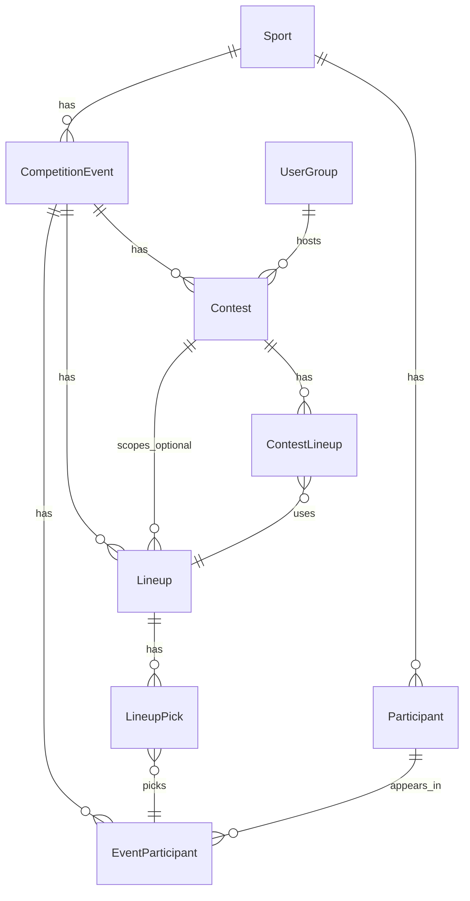

# Server data models (v4 platform)

Schema: `server/prisma/schema.prisma`  
Baseline migration: `20260611153145_init_platform_schema`

Legacy models **`Tournament`**, **`Player`**, **`TournamentPlayer`**, **`TournamentLineup`** were removed on v4.

---

## Identity & social

### User
- Privy-linked (`privyUserId`), profile, `settings` JSON
- `email` is the login inbox. An agent account sets it when the account is created. `pendingEmail` is unused.
- `userType`: `USER` (default), `TEST`, `ADMIN`, `SUPER_ADMIN`, `PUBLIC`, `AGENT`
- Privy dashboard test emails (`test-…@privy.io`) provision as `TEST`. Existing `USER` rows with those emails are promoted to `TEST`. Staff types are not changed.
- Referral fields: `referralCode` (opaque `?ref=` invite code, unique), `referrerAddress`, `referralGroupId`, `referredByUserId`, etc.
- Relations: `lineups`, `contestLineups`, `wallets`, `userGroups`, `botDelegates`

### UserWallet
- `chainId` + `publicKey` (unique per chain)
- `isPrimary` for default wallet
- `ownerAddress` and `pendingOwnerAddress` are stored columns. The live account doors do not write them.

### UserGroup (league)
- **No sport field** — cross-sport by design
- Optional `inviteCode` for self-join

### UserGroupMember
- `role`: `ADMIN` | `MEMBER`

### BotDelegate
- P-256 public key on `delegateAddress`. `kind` is `account` (the key that opened the user) or `grant` (a key the human added). `status` is `pending`, `active`, or `revoked`. The private key stays with the caller.
- `approval` stores the Privy quorum id and, once the signer is on the wallet, the embedded wallet id and address
- Unique per user and delegate address. One `account` row per public key.

### BotActionLog
- `action`: `delegate` | `revoke` | `lineupUpsert` | `join` | `leave` | `error`
- Records that an action happened. Lineup, contest, and transaction hash stay on their own rows

### BotRequestNonce
- Primary key is the replay key (`publicKey` + nonce)
- `expiresAt` is how long that nonce stays consumed

---

## Sport registry

### Sport
| Field | Example |
|-------|---------|
| `id` | `pga-golf` |
| `slug` | URL segment |
| `rosterRules` | `{ slotCount, minPicks: 1, maxPicks, allowDuplicates: false }`. Golf and F1: `slotCount` / `maxPicks` 4. Commodities: 3. A lineup needs at least one pick to save or enter. |
| `scoringRules` | `{ aggregation: "sum", direction: "higher_wins", popularity?: PopularityRules }` — see [consensus-axis.md](../../docs/platform/consensus-axis.md) |

### CompetitionEvent
| Field | Purpose |
|-------|---------|
| `sportId` | FK → Sport |
| `externalId` | Sport-native id (golf: `R2026033`) |
| `isActive` | Only one active per sport (set by init) |
| `metadata` | Sport-specific JSON (name, dates, course, summary, round status, …) |

### Participant
- Global competitor per sport (`externalId`, `displayName`, `metadata`)

### EventParticipant
- Competitor in one event
- `scoreData` JSON (golf: `leaderboardPosition`, hole scores, …)
- `total` — external pick score `e_i` (event-scoped; base for popularity adjustment)

---

## Lineups

### Lineup
- `userId` + `eventId` — **many lineups per user per event**
- `contestId` optional FK — contest lobby always sets it; scopes drafts and duplicate checks per contest
- `prediction` JSON (`{ type: "winningLineupTotal", value: number }`)
- `predictionRules` JSON on `Sport` (`min`, `max`, `defaultRandomMin`, `defaultRandomMax`)
- `name` optional display label

### LineupPick
- `lineupId` + `eventParticipantId`
- `slotIndex` optional ordering

```
Lineup ──< LineupPick >── EventParticipant
```

---

## Contests

### Contest
| Field | Notes |
|-------|-------|
| `eventId` | Determines sport via event |
| `userGroupId` | Optional league scope |
| `address` | On-chain `ContestController` |
| `chainId` | 8453 / 84532 |
| `status` | `OPEN` \| `ACTIVE` \| `LOCKED` \| `SETTLED` \| `CANCELLED`. `CLOSED` is a legacy database value. |
| `settings` | Primary deposit, oracle, expiry, subsidy bps, … |
| `results` | Settlement snapshot JSON |
| `pickPopularity` | `Json?` — per-player popularity after lock (`pickRate`, `bonus`, `adjustedScore` keyed by `eventParticipantId`) |
| `pickPopularityLockedAt` | `DateTime?` — when pick rates were snapshotted |

See [consensus-axis.md](../../docs/platform/consensus-axis.md) for shape and cron write path.

### ContestLineup
- Links `contestId` + `lineupId` + `userId`
- `entryId` — on-chain entry (uint256)
- `score` — final ranked total (`finalScore`)
- `baseScore`, `popularityBonus` — lineup aggregates (sum of picks' `pickPopularity` values)
- `position` — updated during live play / settlement

### ContestLineupTimeline
- Time series of `score` (final total) and `position` per entry for charts

### ContestSecondaryParticipant
- Secondary market buyers indexed from client after on-chain buys
- `amountWei` — cumulative payment-token wei deposited on this `(contest, entry, wallet)` position (optional; null for pre-field historical rows)
- `lastTransactionHash` — most recent buy tx

### OnchainPayment
- Indexed payout rows (`PRIMARY`, `SECONDARY`, `REFERRAL`)

---

## Email

### EmailSendLog
- `dedupeKey` unique — idempotency
- `eventId` optional FK (was `tournamentId` in legacy)
- `kind`: `CONTEST_ANNOUNCEMENT`, `PLAYER_WITHDRAWAL`
- `contestId` optional FK; `status` `PENDING` \| `SENT` \| `FAILED` \| `SKIPPED`

---

## Entity relationship (simplified)



---

## Golf metadata conventions

Stored on `CompetitionEvent.metadata` and `Participant.metadata`:

| Key | Usage |
|-----|-------|
| `name`, `startDate`, `endDate` | Display, email, expiry |
| `course`, `city`, `state` | Event header |
| `status`, `roundDisplay`, `currentRound` | Live state |
| `summarySections` | Tournament preview JSON |
| `pgaTourId` | External id alias |
| Participant `pga_firstName` / rankings | Candidate display |

Tournament preview: `CompetitionEvent.metadata.summarySections` (written by golf `script:golf-event-summary` / auto-init, and by the commodities week brief). `summaryAttemptAt` is the last failed preview attempt for either sport. A retry waits 3 hours.
